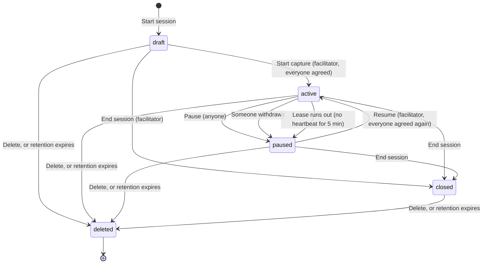
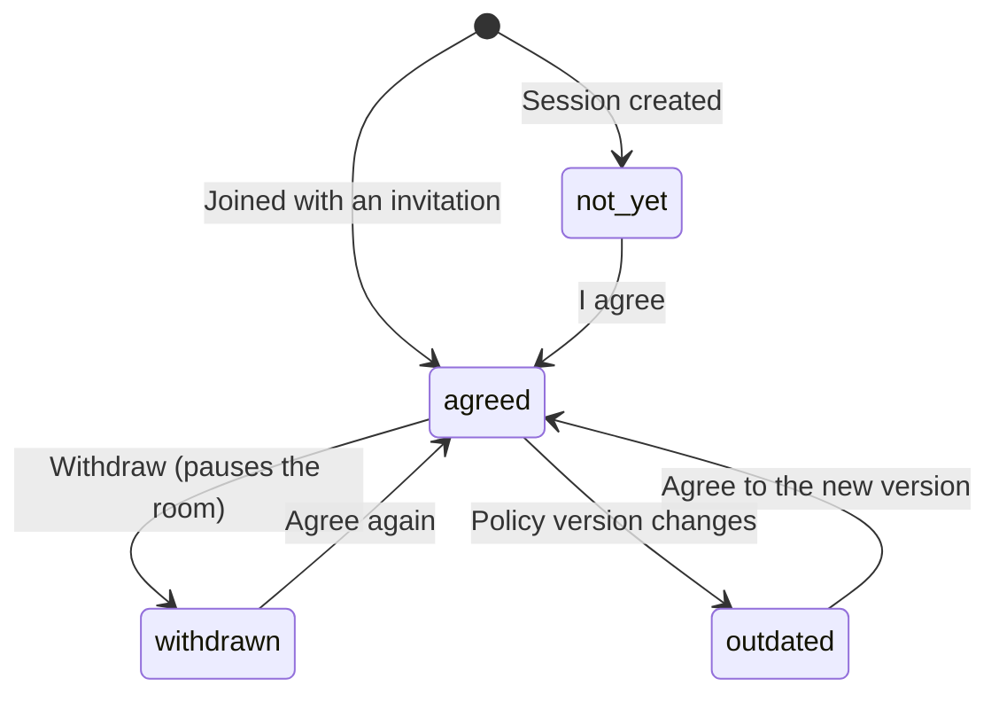
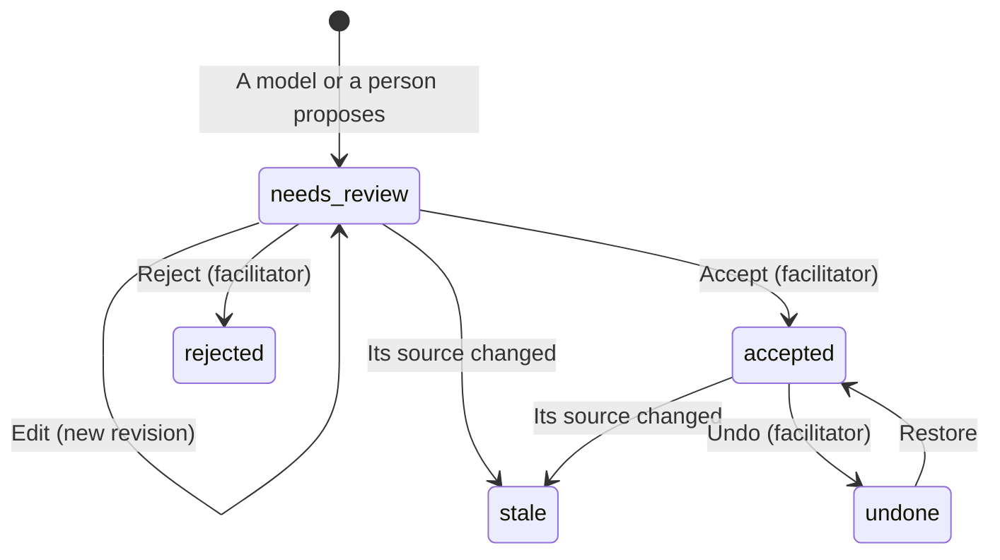
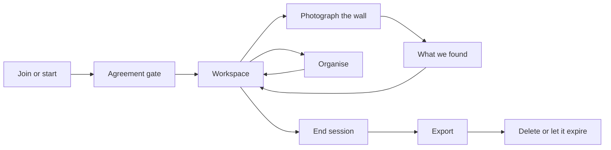

# User flows, path logic and the interface they need, 18 October 2026

The UX half of the redesign: every flow the product has or plans, the logic of
each path including every branch, and what the interface must do to carry it.
The UI half is a new design system for Jarvaids, set out in section 6 and
mapped onto these flows.

Companion to the screen-by-screen [UX inventory](ux-inventory-2026-10-18.md),
which says what is wrong today; this says what should exist. A proposal for the
team: section 7 lists the decisions it needs.

Sources are the product's own documents, checked against the code. Flow
numbers F01 to F36 are stable, so the team can refer to them. Status words:
**built** (the client does it), **partial**, **missing** (the server has it but
the client does not, or it is only designed), **proposed** (not agreed).

## 0. Fix before Tuesday: capture stops itself after five minutes

Activation gives capture a 300 second lease (`service.py:517`); only a
facilitator heartbeat renews it (`service.py:533`), and the client never sends
one (`app.mjs:585`). Both sessions run in the browser on 18 October paused
themselves exactly five minutes after capture started (`session.lease_expired`
at 20:46 and 20:54). Every live demo longer than five minutes loses capture
without a word on screen beyond the state changing to Paused. The client
library already supports heartbeats; the client has to opt in for facilitators.

## 1. People and what they may do

| Role | May | May not |
|---|---|---|
| **Facilitator** (creator; there is always at least one) | Everything a participant may, plus: start, resume and end capture; invite, revoke, change roles, remove; accept and reject; edit and undo accepted items; export; delete the session | Be removed or demoted while the last facilitator |
| **Participant** | Agree and withdraw for themselves; add notes, photos and audio while capture runs; correct their own sources; propose; move notes; change group membership; pause | Accept or reject; export; invite |
| **Viewer** | Read; pause (inferred) | Contribute; see photos or crops |
| **Someone present without a device** | Nothing: the server only counts connected members' agreement | **Gap:** the product promises everyone present agrees (`flowchart.md:53`) |
| **Models** | Make proposals only: readings, transcript segments, command recognition, and (proposed) synthesis | Accept anything, move anything a person placed, act without a person |

A session holds at most 8 members. Who may *command* the tool by voice is an
open question in the flowchart (anyone is chaos, only the facilitator is a
bottleneck).

## 2. Path logic: the state machines

Every screen must show which of these states it is in. Where the current
client hides a state, the flow inventory below says so.

### 2a. Session

- **Pause keeps** agreements and proposals; it cancels queued photo readings.
  Moving, grouping and reviewing still work while paused.
- **Closed is final:** reading, export and delete only.
- **Deleted** purges everything except a receipt; retention (default 24 h,
  60 s to 7 days, chosen at creation) deletes the same way.

### 2b. Agreement, per person

Capture can start or resume only when every current member is in `agreed`.
`outdated` exists in the protocol, but nothing changes the policy today.

### 2c. Capture is two things

| | Session `active` | Microphone listening |
|---|---|---|
| Means | The room has agreed and the facilitator started capture; notes and photos are accepted | This device is sending audio |
| Starts | Start capture | Listen, on each device |
| Stops | Pause, withdraw, lease expiry, end | Stop listening, pause, hidden tab, offline, closing the page, speaker enrolment |

Today the bar says "Recording" for the left column even when no microphone is
on (inventory C3). The interface needs both, distinctly: **"Session open"**
and **"Recording, 12:04"** with a timer, per device.

### 2d. What a person reviews

Kinds: **content** (a note), **relationship** (a group; only `cluster`
exists), **placement** (positions, proposed for machine layout). An
**unreadable** reading cannot be accepted until a person types its text.
Moving and changing group membership never need review and never stale
anything.

### 2e. A photo reading

`queued` then `running` then `succeeded` (one proposal per marked note), or
`failed` (deadline, provider failure, invented or missing regions) or
`cancelled` (pause, source changed). An **uncertain** outcome (the connection
dropped mid-call) blocks a plain retry: retrying needs an explicit "this may
cost again" acknowledgement. **None of these states is visible in the client
today.**

## 3. Flow inventory

Grouped by the phase of a meeting. Priority: **D** needed for the demo,
**1** first redesign round, **2** later, **P** proposed and not agreed.

| # | Flow | Who | Status | Pri. |
|---|---|---|---|---|
| **Set up** | | | | |
| F01 | Start a session | Facilitator | partial: no retention, agenda or per-person agreement | 1 |
| F02 | Invite someone | Facilitator | partial: participant role only; shown to everyone; shown even if it failed | 1 |
| F03 | Join with an invitation | Anyone invited | built; must also type a server URL | 1 |
| F04 | Revoke an invitation, change a role, remove someone | Facilitator | missing | 2 |
| F05 | Agree | Each person | built, self only, as a button | D |
| F08 | Start capture | Facilitator | partial: no "who has not agreed yet" | D |
| **Capture** | | | | |
| F09 | Pause | Anyone | built; red, unconfirmed, named "Stop capture" | D |
| F10 | Resume | Facilitator | built | D |
| F12 | Listen and transcribe | Each device | built, single lane; gaps shown outside the transcript | D |
| F13 | Enrol a speaker's voice | Anyone, while capturing | built; no confirm-the-name step, no delete | 2 |
| F14 | Voice commands | Anyone speaking | recognised: built; executed: missing (WP3) | 1 |
| F15 | Type a note | Anyone, while capturing | built | D |
| F16 | Photograph the wall, read marked notes | Anyone, while capturing | built; job states invisible | D |
| F17 | Retry an uncertain reading | Author, facilitator | missing | 2 |
| F27 | Phone capture | Anyone | missing (designed in `touch.md`) | 1 |
| **Review** | | | | |
| F18 | Accept, edit, reject | Facilitator decides | partial: no evidence shown; participants' corrections are never saved | D |
| F19 | Type an unreadable note | Facilitator, author | partial | 1 |
| F20 | Correct a source or re-mark regions | Author, facilitator | missing | 2 |
| F24 | Edit an accepted item | Facilitator | missing | 2 |
| **Organise** | | | | |
| F21 | Move and place notes | Anyone | built (by hand); machine layout proposed | 1 |
| F22 | Groups: propose, accept, add, remove | Anyone proposes, facilitator accepts | built; no restore | 1 |
| F23 | Undo | Facilitator | missing | 1 |
| F25 | Organise: transcript and notes into structure | Facilitator, or a voice command | proposed ([proposal](proposal-organise-step.md)) | P |
| F26 | Rolling minutes, decisions, actions, questions | Model, reviewed | proposed | P |
| F28 | Ask a question mid-meeting | Anyone | proposed | P |
| F29 | Quiet or Active mode, live suggestions | Facilitator | open | P |
| F34 | Expandable notes, topic colours | Anyone | partial: details show provenance | 2 |
| **Close** | | | | |
| F11 | End the session | Facilitator | missing | 1 |
| F30 | Export | Facilitator | partial: JSON and Markdown; no provisional count first | 1 |
| F31 | Delete the session | Facilitator | built, inside Export | 1 |
| F32 | Retention and expiry | System | built at a fixed default; no choice | 2 |
| **Always** | | | | |
| F06 | Withdraw agreement | Each person | missing, though the text promises it | D |
| F07 | Agree again after withdrawal or a new policy | Each person | missing | 1 |
| F33 | Reconnect, offline, catching up | Everyone | partial: no degradation banner | 1 |
| F35 | Board integration, archive | | proposed; conflicts with 24 h retention | P |
| F36 | Diagnostics | Facilitator | missing | 2 |
| **Lease** | Capture kept alive while the facilitator is present | Facilitator's device | **broken: see section 0** | D |

## 4. The core flows, path by path

For each: the path, every branch, and **what the interface must do**. The
remaining flows follow the same rules and are specified enough by the table.

### F01 to F08: from nothing to capturing

**Path.** Facilitator: name, session title, retention, Start session. Each
person who joins arrives on the agreement step. When every person has agreed,
the facilitator starts capture.

**Branches.** Someone has not agreed (Start capture refused, naming who). An
invitation is expired, used, revoked, mistyped or for an older policy. The
session is full (8), closed or deleted. A retried creation with different
fields.

**The interface must:**
- Lead with **Join**, since most people join; Start is the secondary path.
  The server address belongs in an "Advanced" fold, prefilled.
- Make the agreement **a checkbox with a sentence**, "I agree to this session
  being recorded", then a primary **Continue**. Show the retention in plain
  words before anyone agrees ("Everything is deleted 24 hours after the
  session ends").
- Show **one row per person**: Agreed with the time, Not yet, or Withdrawn.
- Keep **Start capture** disabled with the reason beside it: "Waiting for
  Sam and Jo to agree."
- Tell each kind of invitation failure apart: "This invitation was already
  used. Ask the facilitator for a new one" is not "Could not reach the
  server".
- Invite with a **copy button** and a **QR code**, from the people panel, for
  facilitators only.

### F06, F07, F09 to F11: pausing, withdrawing, ending

**Path.** Anyone pauses; anyone withdraws (which pauses the room); the
facilitator resumes once everyone agrees again; the facilitator ends the
session for good.

**Branches.** Lease expiry (section 0). Withdrawing while others are speaking.
Resuming when someone has not re-agreed. Ending with readings still queued.

**The interface must:**
- Keep **Pause** one press away for everyone, on every device, in quiet
  styling, with no confirmation (it is reversible).
- Put **Withdraw** in the bar next to the agreement record: one click, no
  confirmation, and an assertive announcement ("Jo withdrew agreement.
  Recording stopped.").
- **End session** only via a confirmation that says what is kept and what is
  deleted, with Cancel focused.
- Never let the room believe it is recording when it is not: the paused
  state replaces the timer, and the reason is named ("Paused because Jo
  withdrew", "Paused: the facilitator's connection was lost").

### F12 to F14: listening, speakers, commands

**Path.** Listen on a device; segments arrive per sentence, with the speaker
(device owner, enrolled voice, or "Unknown speaker"); a command addressed to
Jarvaids is recognised and, once WP3 lands, executed.

**Branches.** Microphone refused. A chunk fails to upload. Transcription fails
(a gap). The tab is hidden or goes offline (listening stops). Enrolment
starts (listening stops). A command is unfinished, unsupported, negated or
deferred. Below the confidence gates a command previews or asks instead of
acting.

**The interface must:**
- Show **listening per device**, with a timer, distinct from the session state.
- Say why listening stopped when the device stopped it ("Listening stopped
  because this tab was hidden").
- Show **gaps as rows** in the transcript, at the time they happened.
- Keep **recognised** and **executed** visibly different: "Heard: make a
  summary" is not "Summary made". An executed command links to what it
  produced and offers Undo.
- Keep test tooling (wake-word detector, original wording, vendor names) out
  of the default view, behind "Details".

### F15, F16, F27: notes and photographs

**Path, as it should be.** Photograph (camera or file); the model proposes a
box per note; the person adjusts boxes; Send; "Reading 7 notes"; "Here is what
we found": a row per note with its crop, editable text and confidence;
Add to the canvas. Items arrive provisional; adding is not accepting.

**Branches.** No boxes. A photo too large, multi-frame or undecodable (the
client already converts). A reading fails, times out, or is cancelled by a
pause. An uncertain outcome needs a cost acknowledgement to retry. An
unreadable note waits for typing. A refusal fallback answers with another
model.

**The interface must:**
- Make **Photograph the wall** a primary action in the session bar, not a
  section in a side tab.
- Mark notes **full width**, with model-proposed boxes, a single-box undo, and
  a keyboard path.
- Show **every reading's state**: Queued, Reading, Failed with the reason and
  Retry, Cancelled by pause.
- End with the **found screen** (`touch.md:440-459`) before anything reaches
  the room's canvas.
- On a phone, follow `touch.md` 9a to 9c: shutter, Uploading, Reading notes,
  found, with Cancel throughout and "Not sent. The photograph is still on your
  phone. Capture is still running." on failure.

### F18, F19: review

**Path.** A queue of everything waiting, oldest first. Each item: its evidence
(crop, or the transcript lines it came from), then its text, editable, then
Accept, Edit, Reject. Focus moves to the next item; "Accepted. 11 remaining."

**Branches.** A participant reviews (they may correct, not accept). The item
went stale. Another facilitator accepted it first. Unreadable. Edited after a
model made it (confidence becomes "not measured").

**The interface must:**
- Put the **evidence above the text** in every review item.
- **Save a participant's correction** as an edit they can see, then hand
  acceptance to a facilitator. Today the text box looks editable and the edit
  is thrown away.
- Show "Your corrections are kept as part of the session record" once.
- Mark **Unreadable** as a request for help: the crop, the word, an empty
  field.
- After Accept, offer **Undo in place**, on the row, for a few seconds.
- Offer **no accept-all**, and keyboard keys only while a queue item has
  focus.

### F21 to F25: organising

**Path today.** Drag each accepted note out of "Not placed yet"; select notes,
name a group, propose it, accept it.

**Path proposed.** **Organise** turns the session's transcript and accepted or
waiting notes into points, merged across wall and speech, grouped in a form
(cluster today; timeline, flow, matrix, hierarchy later), placed by a layout
engine as a proposal that never moves anything a person placed.

**The interface must:**
- Offer **Organise** as an explicit step, with the form and a one-line reason
  ("Grouped by topic, because the points are not ordered in time"), and a way
  to recast it.
- Show synthesis output as **provisional groups of provisional notes**, each
  point showing its support (wall, speech, both) and any disagreement.
- Let a person's own grouping **skip review** if the team agrees (inventory
  M7), as moving already does.
- Lay out by group with clear space between groups; show paper colour on
  photo notes (section 7, decision 4).
- Provide **Undo** in the bar for anything a model did.

### F11, F30 to F32: ending and taking it away

**The interface must:**
- Open Export as a **page or side panel, not a modal**, with the provisional
  count first ("4 notes were never reviewed. Include them, marked as
  provisional?"), then the formats, then download.
- Keep **Delete session** separate from Export, behind its own confirmation.
- Say what happens to the data afterwards, with the date: "This session and
  everything in it is deleted on 19 October at 21:08."

### F33: connection

**The interface must** show a single hairline banner for any degradation,
saying what broke and what still works ("Connection lost. Capture on the
server is unchanged. Reconnecting."), and replace it with "Back in sync" when
it recovers. Not the current one-line slot that stays until something else
happens.

## 5. Information architecture

Derived from the flows above, not from the server's command list.

| Region | Holds | Flows |
|---|---|---|
| **Session bar** (always visible, every device) | Session name; session state; per-device recording state with timer; people and agreement (count, opens the people panel); **Photograph the wall**; **Listen**; **Undo**; **Pause**; a menu with End session and Export | F05 to F12, F16, F23 |
| **Canvas** (the hero) | Notes and groups; provisional and accepted; layout by group; selection actions on the items themselves | F21, F22, F25, F34 |
| **Side panel**, one view at a time, non-modal | **Review** (queue with evidence), **Transcript** (with gaps and commands), **People** (agreement rows, roles, speakers, invite) | F02 to F07, F12 to F14, F18 to F20 |
| **Photo flow** (full width, over the workspace) | Mark, Reading, What we found | F16, F17, F19 |
| **Organise** (a step, then back to the canvas) | Form, reason, recast, run | F25 |
| **End and export** (page) | Provisional count, formats, retention date; Delete separately | F11, F30 to F32 |
| **Phone** | Capture first (shutter), then the review queue, then the list; canvas read-only | F27, F18 |

## 6. The UI: a new design system, mapped onto the flows

A proposal for the visual language of the redesign, replacing the look of the
current client. It keeps the product's rules about provenance and consent and
changes how they are drawn.

### Principles

1. **Type carries the hierarchy.** One grotesk family, three weights (300,
   400, 500), six roles. Headings are two lines: ink, then a muted second line.
   No uppercase labels.
2. **One focal point per view**, and the canvas is it.
3. **One hue per screen, in tonal steps.** A single blue accent with its
   lighter and darker steps, a slightly tinted neutral family, and ink.
   Several saturated hues on one screen read as a cheap rainbow.
4. **Colour is light, not line.** The accent fills what is in focus or can be
   acted on; it never outlines a container.
5. **Separate by space first, then a tonal fill, then a line.** Never a fill
   and a line on the same element. A line carries meaning or marks a field.
6. **Thin and petite.** Lines of 0.5 px on small items, 1 px on large ones,
   2 px plus accent for the one relation in focus. Components stay small at
   1440 px so the canvas leads.
7. **State is weight plus a mark, never colour alone.** Status is a shaped
   16 px glyph and a word, so it reads without colour.
8. **Show where a thing comes from.** A person's note, a model's proposal and
   an accepted item never look the same.
9. **Nothing loops.** No spinners, shimmer or pulse; work in progress is a
   word and a still mark. Motion eases out, stays under 300 ms, and moves only
   transform and opacity; reading content never moves.
10. **Light by default, dark for the projector** as its own scheme, not an
    inversion.

### Foundations

| | Values |
|---|---|
| Accent | Blue in seven steps; the working accent at 7.5:1 on the ground, so it reads on a projector |
| Neutrals | Ground, sunken panel, floating surface; ink and muted ink (7:1); a decorative line and a meaningful line (3:1) |
| Status | Good, warning, serious, critical, each a different glyph shape plus a word |
| Type | meta 12/16, body 14/20, title 18/24, heading 28/32, display 44/48, figure 44/44; a **room mode** multiplies by 1.5 for the projector |
| Space | a 4 px grid: 8 inside a group, 24 between groups, 64 between sections, 32 margin; 12 columns |
| Corners | 4, 8, 16 |
| Targets | 24 px at a desk; **44 px in room mode and on touch** |
| Elevation | shadows only on floating surfaces (menus, popovers, dialogs); nothing in the page |
| Motion | 150 to 250 ms for working UI, ease-out; reduced motion keeps fades only |

### Components

Buttons (primary, quiet, plain; a `pending` label instead of a spinner),
icon buttons (always named), fields with the label in the edge, checkbox and
radio rows, switch, segmented control (views of the same content, at most
three), tabs (sections), stepper, combobox, menus and popovers (non-modal),
dialog (blocking confirmations only, safe choice focused), drawer, tooltip
(never the only name), panel (a tonal group, no border), selectable list and
data list (40 px rows, expandable), list states (still skeletons, empty and
error with one action), status glyphs and banner, lifecycle tags (Proposed,
Accepted, Rejected, Superseded), progress and steps, file upload, timeline
with one playhead.

**The review moment.** The pattern the redesign builds around: the canvas as
a graph of notes and groups joined by labelled relations, and beside it the
item under review with a "Proposed" tag, the item, its evidence, a field to
correct it, and "Accept" or "Later". The relation in focus carries the accent
and a 2 px line; everything else stays quiet.

### Mapped onto the flows

| Need | Built from | New for Jarvaids |
|---|---|---|
| Session bar | Icon buttons and quiet buttons (one primary); status glyph with a word; a quiet indicator present on every screen | **SessionBar**, **CaptureStatus** (glyph, word, timer) |
| Agreement gate | Checkbox, button, data list rows; dialog for End session | **ConsentRow** |
| Canvas, notes, groups | Graph language: nodes, labelled relations, labels that never sit in boxes | **Canvas**, **Note**, **Group** outline |
| Provisional versus accepted | Lifecycle tag "Proposed" and "Accepted", fading on change | **Note** states (section 7, decision 1) |
| Review queue | Data list rows; field and text area; button with `pending` ("Accepting…"); evidence on top, caption below | **ReviewItem**, **EvidenceCrop**, **TranscriptQuote** |
| Photo flow | File upload (picking, progress, errors); progress and steps for Uploading and Reading | **RegionMarker**, **FoundList** |
| Transcript | Data list row rhythm; one playhead; throttled announcements | **TranscriptRow**, **GapRow** |
| People panel | Selectable list, data list, menu (role, remove), popover | **InviteCode** (copy, QR) |
| Organise | Segmented control for the form, button, steps | none beyond Canvas |
| End and export | Radio group, checkbox, button, progress; dialog for delete | none |
| Degradation | Status banner | none |
| Phone | Room-mode sizing, 16 px fields, bottom sheet | **CaptureShutter** |

## 7. Decisions needed: where the new design changes current rules

The current design system (`app/design-system/`) is stricter in places. The
new design changes these rules; recommendations below, each the team's call.

1. **How provisional looks.** Now: 1.5 px dashed **violet** plus a
   "Provisional" badge. With one hue per screen there is no second hue for
   provenance.
   *Recommendation:* provisional is **no fill, a 1 px dashed accent line and
   the tag "Proposed"**; accepted is **a tonal fill and no line** (never both).
   The accent fits: a provisional item is exactly where a person can act. It
   keeps the dash-versus-solid signal and drops the second hue.
2. **Status.** Now: an 8 px dot and a word. *Recommendation:* shaped glyphs and
   a word, readable without colour; the six current statuses map onto them.
3. **Toasts and Undo.** Now: no toasts. *Recommendation:* keep that in the
   room; Undo in place on the accepted row, plus the persistent Undo in the
   session bar.
4. **Paper colours.** Photo notes carry a measured paper colour: yellow, pink,
   blue, green. As fills, that is the rainbow the new design avoids.
   *Recommendation:* the paper colour as a small swatch on the note, not its
   fill; topic colour, if any, from at most three labelled categories.
5. **Shadows.** Now: none at all. *Recommendation:* shadows on floating
   surfaces only.
6. **Panels.** Now: no grey panels. *Recommendation:* allow a tonal panel for
   a group; space still comes first.
7. **Modals.** *Recommendation:* the side panel stays non-modal (new); the
   dialog only for End session and Delete.
8. **Touch targets.** Now: 44 px everywhere. *Recommendation:* the meeting is
   **room mode**: 44 px targets and the 1.5 type scale for the projector; 24 px
   only at a desk.
9. **Photographs.** The new design keeps decoration out of the product; photos
   of the wall are evidence, which is content, and stay.
10. **Typeface.** One grotesk family; which one, and its licence, is still to
    choose. Helvetica Neue and Arial stand in.
11. **Keep from the current rules regardless:** model output never looks like
    team output; agreement before capture; no silent failure; nothing a person
    placed is moved by a machine; corrections are kept as evidence.

## 8. Order of work

1. **Before Tuesday's demo:** the heartbeat (section 0); the false success
   messages (inventory M1); "Recording" only while listening (C3).
2. **First round, UX:** session bar with the two inputs and honest capture
   state; agreement gate with rows and withdrawal; review with evidence;
   participants' corrections saved; photo flow with states and the found
   step; end session.
3. **First round, UI:** the new design system's tokens and components, after
   decisions 1 to 8, in a stack the team chooses (question 2).
4. **With the organise step:** Organise, layout by group, groups from
   synthesis, Undo.
5. **Then:** phone capture, people management, export page, voice command
   execution UI.

## 9. Questions for the team

1. Do we adopt this design system, and decisions 1 to 10 as recommended?
2. Stack: rebuild the client as React components, or bring the new tokens and
   look into the current plain-JavaScript client? The second is faster for the
   hand-in; the first gives tested, reusable components.
3. Who may command the tool by voice?
4. How do people present without a device agree?
5. Should a person's own grouping skip review?
